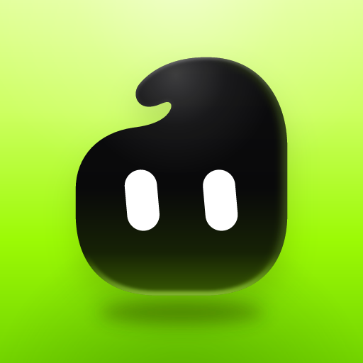

  

<h1 align="center">DougBot</h1>

<b>O workspace onde pessoas e agentes de IA trabalham juntos.</b>

  <a href="https://dougbot.app">dougbot.app</a> ·
  <a href="https://github.com/DougBotAPP/dougbot">Código</a> ·
  <a href="https://github.com/DougBotAPP/dougbot/blob/main/docs/self-host-convidados.md">Instalar no seu servidor</a> ·
  <a href="https://github.com/DougBotAPP/dougbot/blob/main/.github/CONTRIBUTING.md">Contribuir</a>

---

Conversas, tarefas, arquivos e rotinas num lugar só, com agentes que entram nos canais, fazem o trabalho
à vista de todos e pedem aprovação antes de qualquer coisa sensível. Cada agente tem papel, responsável e
orçamento, usa os apps da empresa e tem um computador e um navegador próprios.

### Três jeitos de usar

| | |
|---|---|
| **Na nuvem** | Crie a sua conta em [dougbot.app](https://dougbot.app). Nada para instalar. |
| **No seu servidor** | `curl -fsSL https://dougbot.app/install \| sh` · [guia para convidados](https://github.com/DougBotAPP/dougbot/blob/main/docs/self-host-convidados.md) |
| **No celular** | App para iPhone e Android, o mesmo para a nuvem e para o seu servidor. |

### Por convite

O repositório [`DougBotAPP/dougbot`](https://github.com/DougBotAPP/dougbot) é privado. Quem é convidado
vê o código, instala a imagem e manda correções: um PR que entra aqui chega para todo mundo, no
dougbot.app e em cada servidor, na atualização seguinte.

### Licença

AGPL-3.0, baseado no projeto aberto [agentes.chat](https://github.com/agentes-chat/agentes-chat).
